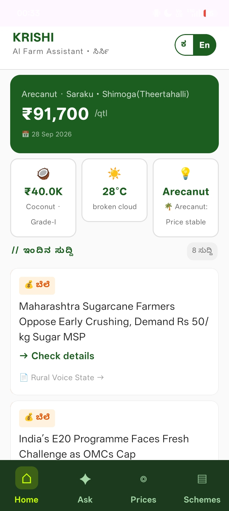
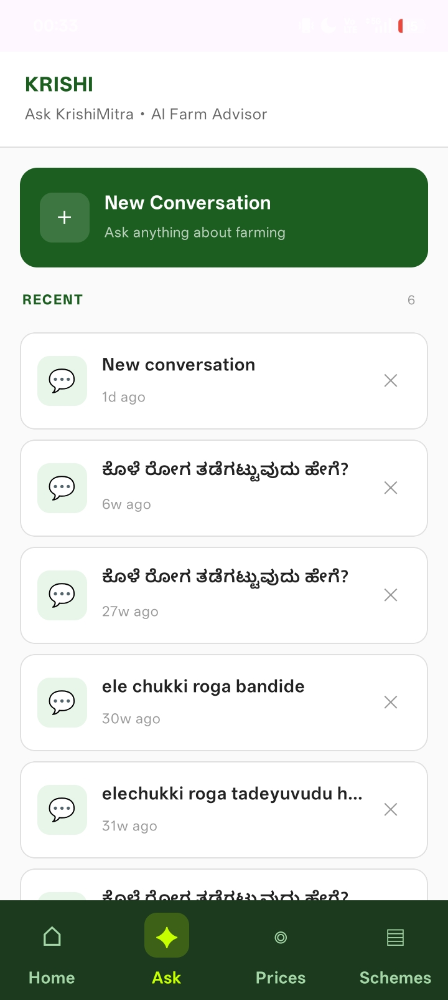
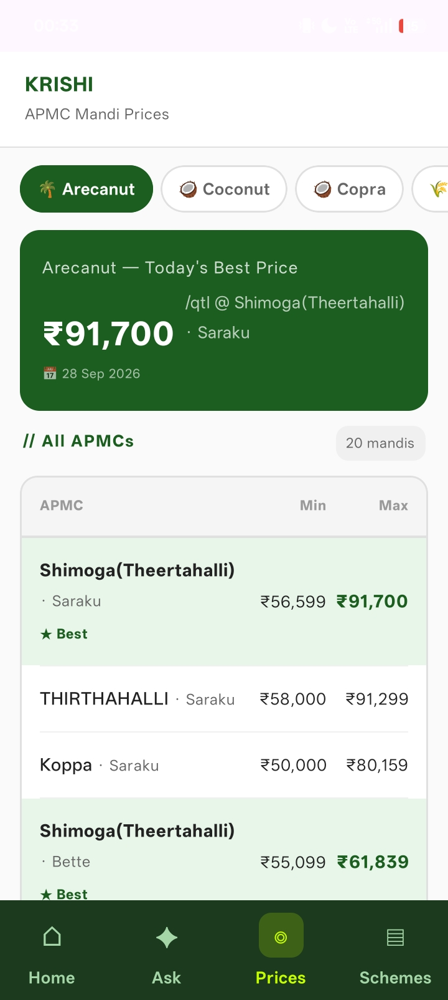
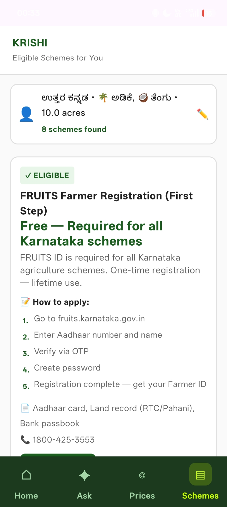

# KrishiMitra — AI farm assistant for Karnataka

A bilingual (ಕನ್ನಡ / English) Android app that gives small farmers in coastal Karnataka
the three things they check every day: **today's mandi prices, an AI farm advisor, and the
government schemes they're eligible for**. It's built on a zero-cost stack.

- **Backend (live):** [KrishiMitra API docs](https://sisaram-krish.hf.space/docs)
- **Android APK:** see [Releases](../../releases)

| Home | Ask | Prices | Schemes |
|---|---|---|---|
|  |  |  |  |

## What it does
- **Home:** today's best price for your crop, the weather, a price insight, and a daily news digest.
  Each headline is translated into Kannada with a one-line "what to do" action.
- **Ask (AI farm advisor):** ask in Kannada, English or transliterated Kannada ("ele chukki roga").
  Answers are grounded in a curated agricultural knowledge base and the latest digest, and tailored
  to your district and crops. Chats are kept on the device.
- **Prices:** daily APMC mandi prices for arecanut, coconut, copra, paddy, pepper, cashew and banana.
  Shows min/max per market and variety, and highlights the best market.
- **Schemes:** filters government schemes by your profile (district, crops, land size). Each
  scheme shows how to apply, the documents needed and the helpline.
- **Kannada / English toggle** across the whole app.

## Architecture
```
Android app (Kotlin, Jetpack Compose, Room)
        │  REST
        ▼
FastAPI backend (Docker on HuggingFace Spaces)
  ├─ /ask      → retrieval (ChromaDB knowledge base) + farmer profile + digest → LLM
  ├─ /digest   → RSS feeds → keyword scoring → one small LLM call (Kannada translation + actions)
  ├─ /prices   → mandi prices from Supabase
  ├─ /weather  → OpenWeather
  └─ /schemes, /profile, /insight
        │
        ▼
Supabase (PostgreSQL) ◄── GitHub Actions, 5×/day: generate digest + scrape and upsert mandi prices
```

## Design decisions
- **Keyword-first filtering before the LLM.** News is fetched, categorised and scored with plain
  keyword rules (target crops, Karnataka districts). Only the top 8 headlines go to the model, in a
  single call. This cuts token usage by about 90% compared with sending whole articles.
- **Multi-provider LLM fallback on free tiers.** Chat tries Gemini → Groq → Sarvam. Digests use
  Groq first to keep Gemini's daily quota free for farmers' questions. If every provider fails,
  the user sees a Kannada apology instead of a crash.
- **Built for rural networks.** 30-second timeouts, a local Room cache for chats and digests, and a
  JSON backup of each digest if Supabase is unreachable.
- **Zero running cost.** HuggingFace Spaces, the Supabase free tier, GitHub Actions cron and free
  LLM quotas.

## Tech stack
- **Android:** Kotlin, Jetpack Compose, Room, REST API client, MVVM (ViewModels + repositories)
- **Backend:** Python, FastAPI, Pydantic Settings, httpx, feedparser, BeautifulSoup, ChromaDB, Supabase
- **Infra:** Docker, HuggingFace Spaces, Supabase (PostgreSQL + SQL migrations), GitHub Actions
- **LLMs:** Gemini 2.0 Flash-Lite, Llama 3.3 70B (Groq), Sarvam-M

## Run it locally
**Backend**
```bash
cd backend
pip install -r requirements.txt
# create a .env file with the keys below
uvicorn app.main:app --reload
```
Environment variables: `GEMINI_API_KEY`, `GROQ_API_KEY`, `SARVAM_API_KEY`, `SUPABASE_URL`,
`SUPABASE_KEY`, `OPENWEATHER_API_KEY`, `DATA_GOV_IN_API_KEY`. Set up the database with
`supabase_setup.sql`, then the files in `migrations/` in order.

**Android**
Open `android/` in Android Studio. Point `BASE_URL` in `app/build.gradle.kts` at your backend, then run.

## Repository layout
```
android/   Kotlin + Compose app
backend/   FastAPI service, migrations, Dockerfile
docs/      UI mockups and implementation plans
.github/   scheduled ingest workflow
```
